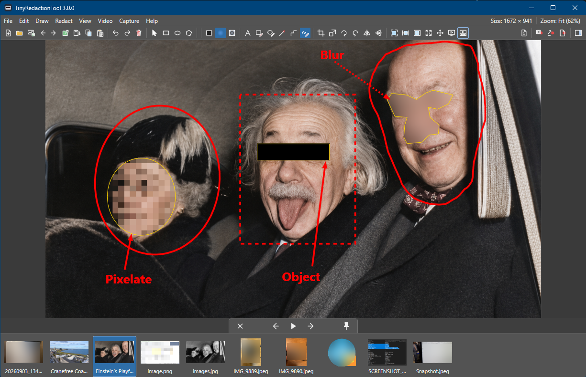

# TinyRedactionTool 3.1

A lightweight Windows tool for redacting and editing sensitive areas in videos and images using black box, blur or pixelation. It supports multiple selection shapes, frame-range redactions, broad media input support and a standalone single-EXE build with an embedded custom FFmpeg.

Everything happens on your computer: no telemetry, no uploads, no online services.

> **For anything that must not be read, use the black (coloured) box.** Blur and Pixelate hide appearance but are not guaranteed removal.

## Download

Get **TinyRedactionTool-3.1.3.exe** from the [latest release](https://github.com/mccabedd/tinyredactiontool/releases/latest) and run it. It needs no installing.

- TRT 3.1 needs Microsoft's free **[.NET 10 Desktop Runtime](https://dotnet.microsoft.com/download/dotnet/10.0)** (Windows x64). If it is missing, Windows says so when TRT starts and offers to open the download page.
- The file is not signed, so Windows SmartScreen may warn the first time. Check the download against `SHA256SUMS-v3.1.3.txt` in the release.
- TRT v2.5.1 (the previous, self-contained version) is still available from its own release, and its source is in [history/v2.5.1](history/v2.5.1).

## What it does

- **Redact** pictures and videos with rectangles, ovals and polygons, filled with a solid colour, blur or pixels (Default or Aggressive). Move, resize and turn them with the mouse, or nudge them with the arrow keys.
- **Videos:** track a moving subject frame by frame, or keep a box in place for a range of frames; trim, crop, append and capture frames, and choose the frames each note starts and ends on. The timeline shows every redaction and note. Sound is removed unless you choose to keep it.
- **Annotate** with text, outlines, ellipses, lines and arrows, polylines and a pen. Add, paste or create images.
- **Layers:** move redactions and notes up or down, duplicate them, or flatten them into the picture.
- **Capture** the screen: region, freehand, window or object, full screen, scrolling windows (long web pages), screen recordings and a screen ruler. A small capture bar and a notification-area icon keep it at hand.
- **Crop, resize, rotate and flip**; zoom, full screen, slideshow, folder navigation bar; animated GIFs play and export animated.
- **Export** PNG, JPG, GIF and WebP pictures and MP4, MOV, M4V, AVI, MKV and WebM videos. Every export is checked after writing (streams, frames, timing and the redacted pixels) before it is kept. Hidden details such as GPS position are not copied. The original is never changed (unless you choose secure deletion after a checked export).
- **Privacy:** screenshots and working copies live in a private temporary folder and are overwritten and deleted when closed, on quit, or on demand with *File › Remove History*.
- Light and Dark themes, a configurable toolbar and capture bar, keyboard shortcuts and a full **Help manual** (Help › Help, or F1).

## Help

The illustrated manual is [docs/help/TRT-Help.html](docs/help/TRT-Help.html). TRT ships with it and opens it from **Help › Help** (F1).

## Building from source

Windows x64 and Windows PowerShell 5.1 are needed. Nothing is installed machine-wide. Use a short folder path (for example `C:\src\trt`): the .NET SDK has deep folders, and Windows refuses paths over 260 characters.

1. `Bootstrap-Dev.ps1` downloads only the pinned .NET SDK and packages and checks their hashes.
2. Put the approved FFmpeg and FFprobe binaries (hashes in [THIRD-PARTY.md](THIRD-PARTY.md)) in `tools/`.
3. `Build-Dev.ps1` builds offline and runs the 1,410 checks.
4. `Package-Standalone.ps1` makes the single `.exe` in `standalone/<version>/`.

See [docs/ARCHITECTURE.md](docs/ARCHITECTURE.md) for how it fits together.

## Licence

GPL-2.0-or-later. See [LICENSE](LICENSE) and [THIRD-PARTY.md](THIRD-PARTY.md) for the bundled components (libVLC, FFmpeg).

## Project status and support

TinyRedactionTool was created and security-reviewed with AI assistance.

TinyRedactionTool’s own source code was written for this project and does not copy source code from other applications. It uses third-party components under their own licences (FFmpeg, libVLC, LibVLCSharp and .NET); see THIRD-PARTY.md. TRT draws its own icons and artwork.

The repository and release files are provided **as is**.

Issues and pull requests are not actively monitored, and individual troubleshooting/support cannot be guaranteed.

Forks and adaptations are welcome. If you reuse the project, please retain attribution or otherwise acknowledge the original project.

## Acknowledgements:

FastStone and their amazing FSCapture tool for the inspiration.

